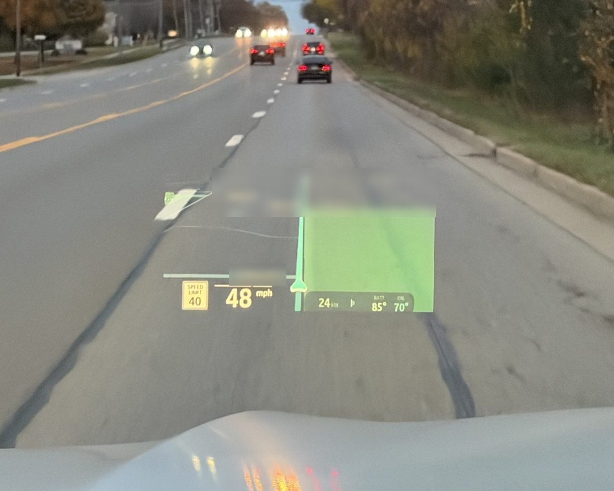
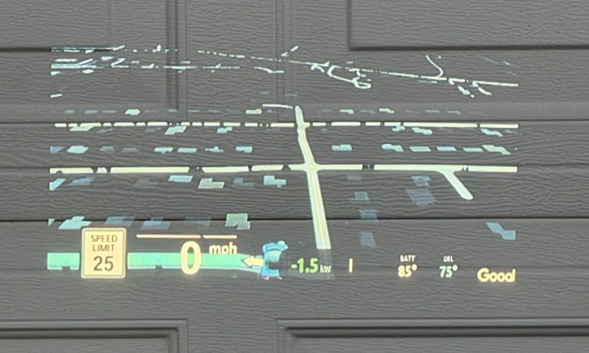
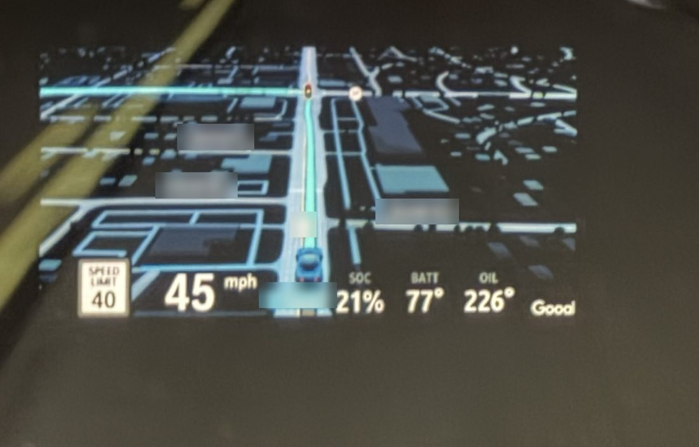
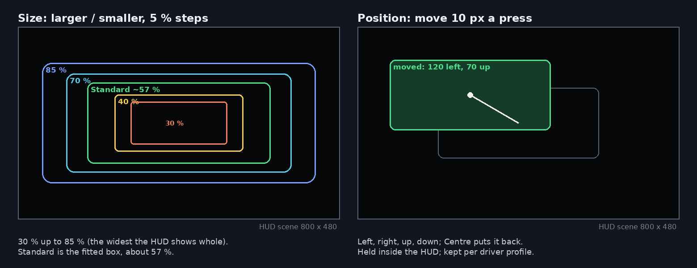
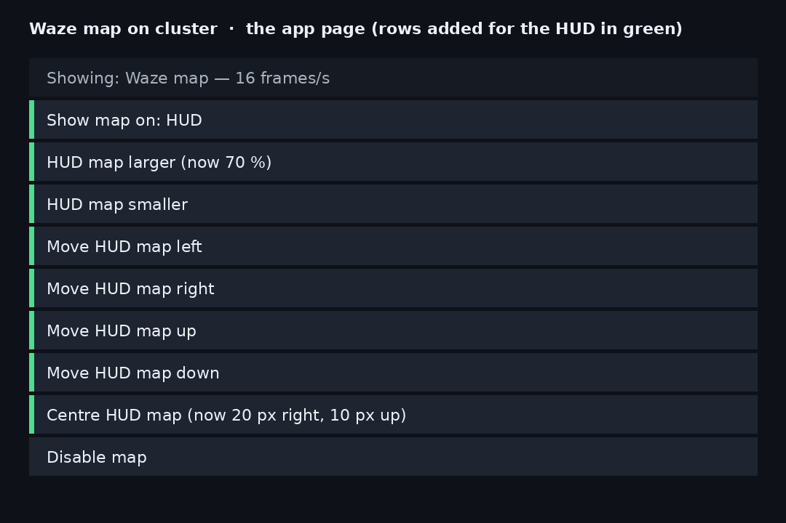
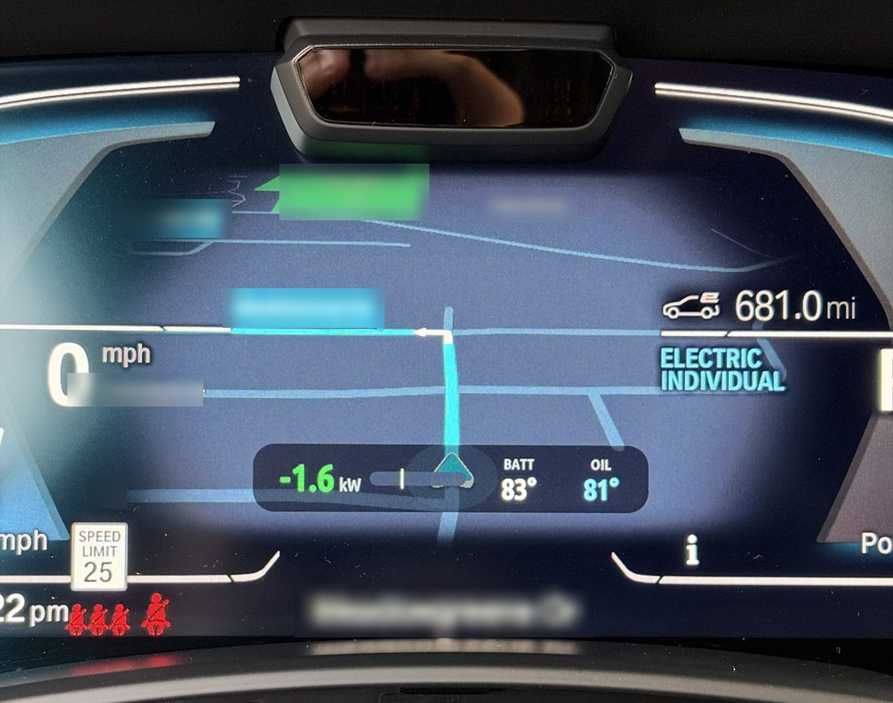

# CarPlay HUD and Cluster Studio for BMW iDrive 7

**New: CarPlay HUD 0.4.117 + Cluster Studio 0.1.0.** Open Overview → Cluster Studio for a full-cluster designer, 100 preset combinations, Ultra-inspired styling, movable widgets, saved designs and an X4 M welcome. Full-screen output is a guarded 10-second parked test, not a road-ready factory-gauge replacement. [Guide and previews](docs/cluster-studio/README.md).

Personal fork of [eroobeeroo/idrive-apps](https://github.com/eroobeeroo/idrive-apps),
with BMW-inspired graphical settings and an **optional experimental Dashboard startup mode**.

Update versions: app **0.4.117**, map tool **0.7.113**, and **MGU Renderer 0.6.11**.
MGU Renderer comes from the official MGU Store source; it draws the settings app
and is separate from the existing cluster-render tool.

[See the new settings screens](docs/hud-research/DESIGN.md). A source commit alone is not
an installable release. Use the [Releases](https://github.com/antonioshamo/carplay-hud/releases)
page to confirm that the `catalog` release and both versioned artifacts exist.

## Install and test

In MGU Store add the public GitHub source:

```text
https://github.com/antonioshamo/carplay-hud
```

If Waze on cluster is already installed from another source, Store will block
this fork from replacing it. For a source migration, note your settings, remove
**Waze on cluster (App)** and then **Waze on cluster (Tool)** from Installed.
Leave the working **cluster-render** installed: it satisfies this fork's renderer
dependency. Install Waze on cluster from **antonioshamo/carplay-hud**, then verify
Installed shows App 0.4.116 and Tool 0.7.113. Follow any restart notice from Store.
Removing a source alone does not transfer ownership of its installed packages.

Already using this repository? Refresh Store and update the App and Tool in place; no removal is needed.

Open the app and choose **Overview → Windshield HUD**. This saves the target for
the next head-unit start. For the route-free trial, while parked:

1. Press **Overview → Enable CarPlay auto-start**. It confirms the live and saved HUD target before enabling the trial.
2. Reconnect CarPlay, leaving its **Dashboard map visible on the center screen**.
3. Do not start a navigation route. Check whether a fresh map appears on the HUD.
4. To stop the trial, press **Overview → Auto-start with CarPlay: ON**.

The helper now listens for CarPlay from boot, even before you opt in. Capture stays
off until enabled. A foreground event received before opt-in is retained, so opening
the app to enable the trial no longer discards it. A connection that predates the
helper still requires reopening or reconnecting CarPlay. The app can be closed. It yields to the normal secondary map feed and hides when
CarPlay is covered by BMW menus or frames stop. Size and position follow the app's
settings. Dashboard trial frames use original colors and square corners.

**Not yet car-validated.** This mirrors the center-screen map; it does not force
Apple to start an independent secondary map stream. The layout classifier, screen
capture format, CarPlay event subscription and physical HUD output require a
parked test on the target car. If the classifier rejects the screen, the trial
stays hidden. No new firmware patch or automatic navigation route is used.

## Settings and missing streets

The new graphical app has Overview, Map layout, Appearance, Startup and Help
sections, with large touch targets and iDrive dial input. It fits inside the BMW
app area and yields when another screen or popup takes focus. If graphics are
unavailable, the fourteen native settings pages remain usable; you can also select
**Help & setup → Classic settings**. In Classic settings, direct HUD and startup
buttons remain on Home. Choose **Appearance → Original map colors** to preserve faint pixels removed by the existing HUD dark-background
filter. This applies to the normal map feed. It cannot restore roads absent from
Apple's source video or lock Apple Maps' geographic zoom. The reported loss on
both cluster and HUD still needs a source capture to diagnose.

BMW's MPH and speed-limit widgets remain in their existing positions. This
release does not move them, remove Apple's instruction banner, or implement
CarPlay Ultra. No proprietary BMW SDK, car binaries, keys or private logs ship.

[Startup experiment details](native/waze-on-cluster/startup/README.md) ·
[Research and validation limits](docs/hud-research/SETTINGS.md)

---

# idrive-apps

Tools and apps for the iDrive 7 head unit (MGU) of a BMW, installed from the
[mgu Store](https://github.com/robertnisipeanu/mgu-store).

| Path | |
|---|---|
| [`native/cluster-render`](native/cluster-render) | the cluster renderer: one service that draws every app's layers on the instrument cluster and the HUD, on iDrive 7 and iDrive 8 |
| [`native/waze-on-cluster`](native/waze-on-cluster) | the CarPlay map (Waze, Apple Maps or Google Maps) on the instrument cluster, drawn through cluster-render |
| [`apps/robertn_waze_cluster`](apps/robertn_waze_cluster) | the iDrive app for it: Enable map, Disable map, status |
| [`release`](release) | builds and publishes the Store catalog |
| `tools` | `oap_pack.js`, `oap_link.js`: pack the app |

## This fork: the map on the HUD

[eroobeeroo/idrive-apps](https://github.com/eroobeeroo/idrive-apps) adds the head-up display: the CarPlay map
(Waze or Google Maps) shown on the HUD instead of the instrument cluster, switched from the app's page. Photos
from a 2021 X5 xDrive45e (G05); street names blurred.



*The HUD map while driving: the route, the next streets and the speed readout over the road. (The panel at the
bottom right, battery power and temperatures, is the separate [Cluster Info](https://github.com/eroobeeroo/idrive7-apps)
app.)*

| Before: Waze's grey-blue night field on the HUD | After: the background made black, which a HUD shows as nothing |
|---|---|
|  |  |

What it does:

- **Show map on: Cluster / HUD** - one button moves the map between the instrument cluster and the HUD, at once.
- **Size** - **HUD map larger / smaller** in 5 % steps from 30 % to 85 % of the HUD's width (85 %: the widest it
  shows whole), the picture's shape kept. Standard is the fitted box, about 57 %.
- **Position** - **Move HUD map left / right / up / down**, 10 px a press, and **Centre HUD map**. The map moves
  at once (only its place changes, nothing is re-sent) and is held inside the HUD.
- **Made for a HUD** - the frames are scaled on the head unit to the size shown (sharper, 2-6x less data to the
  instrument cluster), the corners are rounded, and a night map's background is made black so only the roads,
  route and labels float in view (green, such as parks, is kept).
- **Gives way** - the map steps aside while the HUD's own media and list pop-ups show, so they stay on the HUD.
- **Per driver** - the display choice, size and position are kept for each driver profile and follow the
  driver when the profile changes.





On the cluster, as before, the map fills the central area:



## Install

In the Store, add the GitHub source `antonioshamo/carplay-hud` and install
**Waze on cluster**. The Store installs what it requires first: `mgu-deploy`
0.7.0 from mgu-store, then `cluster-render` and the Waze tool from here. One
head-unit start activates the CarPlay patch. The Store removes them again:
the app, then the tool, then the renderer.

## Build

```sh
make -C native/cluster-render test test-x86 target    # host tests; the unit's toolchain and binary (Docker)
make -C native/waze-on-cluster test test-x86 target
node apps/robertn_waze_cluster/tools/test_control.js
node apps/robertn_waze_cluster/tools/test_page.js
node release/test/release_test.js
node release/release.js check                         # reproducible artifacts
```

Each folder's README has the details; [`release/README.md`](release/README.md)
covers versions, the catalog and publishing.

## License

GPL-3.0-or-later ([`LICENSE`](LICENSE)), unless a file's SPDX header says
otherwise. What apps compile in or copy from cluster-render, its `include/`,
`client/`, `kit/`, `js/cluster_render_client.js` and `PROTOCOL.md`, is
MPL-2.0 ([`LICENSES/MPL-2.0.txt`](LICENSES/MPL-2.0.txt)). Third-party files
keep their own licenses: the RAMSES and vsomeip interfaces in cluster-render
(MPL-2.0), the Intel Media SDK headers in waze-on-cluster (MIT).
