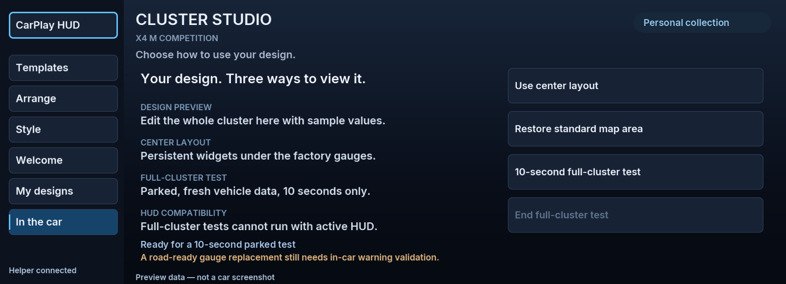
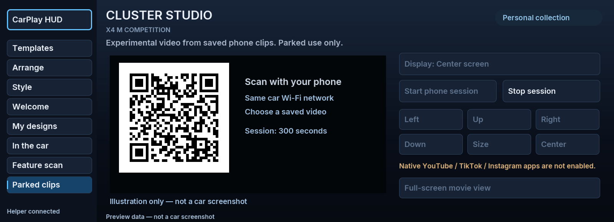

**0.4.123 SDK loading compatibility:** Explicitly enables screen and entry-point loading, which some SDK 27.x donors disable by default ([documented upstream failure](https://github.com/cauliflowermossgrape/idrive7-apps/issues/39#issuecomment-6546607787)). The affected car still could not open 0.4.122. Two new linked-package regression scenarios fail with its empty configuration and pass with these flags; actual vehicle launch remains unconfirmed. Update the App, then restart the head unit while parked before testing.

**0.4.121 installation recovery:** The app manifest now uses the pre-Studio (0.4.116) interface contract after a vehicle rejected 0.4.120 at `generateSomeipInterfaces`. Optional vehicle-data proxies no longer block installation. HUD controls and the editor remain; live-data-dependent Studio tests (including parked clips and feature scan) stay unavailable until compatible telemetry is verified. This is an installation hotfix, not a claim those experiments work on this car.

# Full cluster, lighting and parked media experiments

CarPlay HUD **0.4.121**, Cluster Studio **0.1.3**. No physical BMW validation was available for this build. Update both **Installed** entries in MGU Store using `antonioshamo/carplay-hud`. The map tool remains 0.7.114. This release does not change the CarPlay route-free startup trial.

## Full-cluster test

Open **Cluster Studio → In the car**, choose 10, 30 or 60 seconds, and press **Start full-cluster test**. Choose your template first. Fresh speed below 0.1 km/h and gear P are required. Turn off the HUD map first: the full panel and HUD share a renderer scene. An unknown HUD state also blocks the test.

The full panel is a genuine 1920 × 720 output over the factory gauges. It is not a verified driving replacement. Missing vehicle readings remain dashes. Movement, non-P, expired readings or timeout end the test. The gauge layer and welcome carry short renderer-side expiry leases, renewed while the helper can still validate the test. The ordinary center layout resumes afterward if previously enabled.

## Parked clips and movie view

1. Connect your phone to the car's Wi-Fi. Keep the car in Park.
2. Open **Cluster Studio → Parked clips**. Choose center screen, cluster center, full cluster or HUD, then **Start phone session**. Full cluster requires HUD ownership to be idle.
3. Scan the QR code. Select a video saved on your phone, or enter a **direct HTTPS video file URL** whose host allows cross-origin playback. Press **Send picture to the car** and keep the phone page open.
4. Center screen: keep the app visible, then choose **Full-screen movie view**. This fills the app's available area while keeping Exit and Stop controls; BMW's reserved HMI areas remain.
5. Cluster/HUD: use Left, Right, Up, Down, Size and Center. The picture keeps its aspect ratio inside the chosen area.
6. **Stop session** closes access and removes the frame/layer. Global **Restore BMW defaults** also stops media.

This is a **five-minute experimental session**, not a finished movie-night system. The phone decodes and sends unprotected frames: 640 × 360, up to 15 fps. The app's UI still requests 60 fps; this experimental video source is not claimed to be 60 fps. Audio stays with the phone's selected output and has no synchronization guarantee. Neither clips nor account credentials are saved to the car. A decoder/format, network or source restriction is reported instead of claiming playback.

The listener is created only for an explicit session, bound to a private Wi-Fi address (the car's `wlan_bridge` is preferred), paired with a random token, and restricted to that Wi-Fi interface/address/port by one temporary firewall rule. It never opens the vehicle Ethernet interface. The helper removes its own rule at shutdown/startup; systemd runs cleanup after service exit. No firewall policy is disabled. Phone frame requests are bounded and origin-checked. The session stops on movement, stale Park data or expiry; interrupted video frames disappear, and center playback is removed when helper status goes stale.

## Lighting and browser discovery

Use **Feature scan → Scan this car** while parked. This reads the firmware's own `/etc/oap/someip/someip-interfaces.json`, finds candidate interior/ambient-light and media interfaces, and retains bounded schema information: names, declared getters/setters and type/enum definitions. It also checks a small list of browser/player executable paths without running them. It does not read or change live lighting settings, use diagnostic coding, or assume that an interface or binary proves support.

To collect the result in the same session, open **Parked clips → Start phone session**, scan the QR, then press **Download feature scan** on the phone. Keep that report private and bring it to the combined vehicle session. No VIN, live location, account tokens, complete firmware catalog or video content is included by the scanner.

Lighting **is not enabled in this build**: no verified iDrive 7 setter contract or baseline is available yet. The next step is to use the actual report to build a narrowly scoped adapter that reads and preserves the original setting, invokes a supported operation, and checks the resulting state. Unknown values and fields must remain disabled.

## Web browsing, Prime Video and social apps

This build **does not include a web browser**, install Prime Video, or enable native YouTube/TikTok/Instagram. A website page is not a direct video file, and the phone-frame relay cannot read another site's protected player. Prime downloads inside its app are not ordinary exportable movie files.

Research found a real video frame interface in the existing renderer, which is what the clip relay uses. That interface provides a display surface, not a browser, service login, DRM implementation, audio routing or a licensed AirPlay video receiver. Installing a modern browser on this embedded Linux unit also needs compatible system libraries and a verified graphics/input/audio path. Browser/player candidates in the scan are evidence for investigation, not automatically launched programs.

Amazon documents supported desktop browsers and operating systems; that does not establish compatibility with the MGU. Apple documents parked video/AirPlay for compatible cars, plus app entitlements. No such receiver capability has been established on Antonio's unit. These are concrete blockers to claiming a working Prime Video link, not a conclusion that it can never be supported.

## Primary sources and compatibility findings

- [Cluster renderer protocol](../../native/cluster-render/PROTOCOL.md): `panel`/`map`/`hud`, decoded YUV atlas and stale-frame suppression. Read with the local slot definitions and shared-scene limitation.
- [MGU renderer protocol](https://github.com/robertnisipeanu/mgu-store/blob/main/native/mgu-render/PROTOCOL.md): shared-memory I420 video, foreground gating and video file format.
- [MGU Store phone-page implementation](https://github.com/robertnisipeanu/mgu-store/blob/main/native/mgu-updater/js/web.js): `wlan_bridge` and the firmware's input firewall. Our listener uses a separate, scoped rule and token.
- [MGU SDK and interface catalog](https://github.com/cauliflowermossgrape/idrive7-apps): firmware-generated SOME/IP definitions; catalog data types, read/write declarations and vehicle data.
- [IterioDev's documented overlays](https://github.com/IterioDev/car-apps#overlays-tool-iteriodev-overlays-idrive-8-only): ambient-color switching is reported for iDrive 8/G8x. That is not evidence of an identical setter or color palette on an iDrive 7 X4. No restricted source or binary from that project is redistributed here.
- [Apple CarPlay](https://developer.apple.com/carplay/) and [CarPlay video apps](https://developer.apple.com/videos/play/wwdc2026/212/): compatible receiver and app support are required.
- [Amazon's computer requirements](https://www.primevideo.com/help?nodeId=GUX9FYHU5D8LC9EJ) and [supported devices](https://www.primevideo.com/help/?nodeId=GXMWDGNCPX2JLPFH): no verified MGU browser path was established.

## Validation boundary

Local tests exercise actual Unix-socket and HTTP requests, pairing/origin rejection, bounded I420 frames, shared-file replacement, freshness and Park shutdown, session expiry, HUD contention, placement bounds, renderer leases and targeted firewall cleanup. The actual phone page decoded a test MP4 and delivered frames to the local helper. The graphical client test verifies video registration/rebinding and removing center playback on stale helper status. UI images above are rendered from the code, not car photos.

Car Wi-Fi reachability, the firmware firewall, display output, audio choice, frame rate, factory warning priority and lighting contracts still require the combined vehicle session. Follow [VEHICLE-SESSION.md](VEHICLE-SESSION.md).
