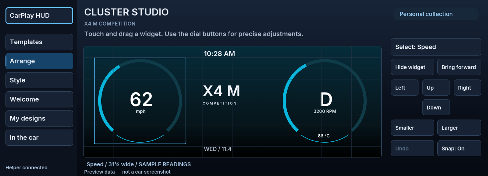
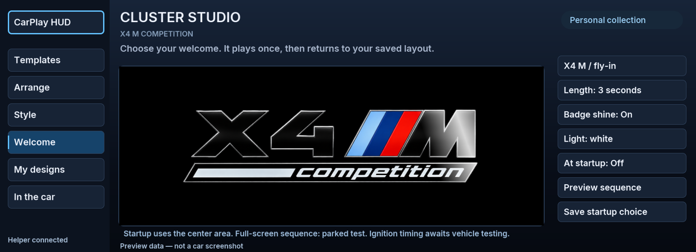
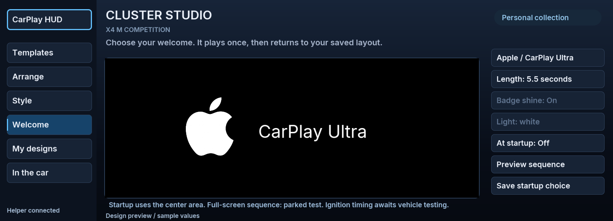
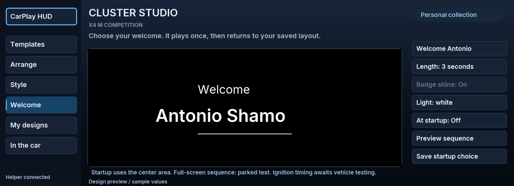

**0.4.122 app launch recovery:** Explicit first-screen opening, deferred optional graphics/profiles and on-demand settings-page resources. Ten startup scenarios run on Node 8, including a linked package with a synthetic SDK. Car installation succeeded on 0.4.121; this launch fix still needs in-car confirmation.

**0.4.121 installation recovery:** The app manifest now uses the pre-Studio (0.4.116) interface contract after a vehicle rejected 0.4.120 at `generateSomeipInterfaces`. Optional vehicle-data proxies no longer block installation. HUD controls and the editor remain; live-data-dependent Studio tests (including parked clips and feature scan) stay unavailable until compatible telemetry is verified. This is an installation hotfix, not a claim those experiments work on this car.

# Cluster Studio 0.1.3 / CarPlay HUD 0.4.122

A full-cluster visual designer for Antonio's X4 M Competition, integrated into
**CarPlay HUD → Overview → Cluster Studio**. Install the Cluster Studio tool
alongside the app. All screenshots below are generated from the actual UI drawing
code with sample readings; they are not photographs of a running car.

## What you can customize

- 100 preset combinations: ten layouts × ten palettes. Includes **Ultra / blue rings**,
  M Competition, Grand touring, Minimal, Panorama, Driver focus, Technical,
  Night drive, Symmetry and Track paddock. These are not 100 independent features.
- Twelve movable elements: speed, RPM, gear, clock, date, X4 M Competition badge,
  checkered flag, coolant, oil temperature, M-color stripes, signature and data status.
- Touch dragging; dial-accessible select/left/right/up/down controls; size, visibility,
  stacking, 1% snapping, and 30-step undo. Every widget stays within the canvas.
- Four gauge treatments, ten palettes, three backgrounds, widget cards, mph/km/h,
  12/24-hour time and five signature choices.
- Five personal templates saved on the head unit. Loading a template makes a draft;
  **Apply center layout** or **Save** is explicit. Save confirmations come from the helper.
- Startup options: **X4 M fly-in**, **X4 M reveal**, **Apple logo → CarPlay Ultra**,
  **Welcome Antonio Shamo**, and **None**. Choose 3 / 4.5 / 5.5 / 7 seconds,
  badge shine on/off, white/blue/red/theme lighting, and startup on/off.
  The Apple sequence defaults to 5.5 seconds: logo hold, slide left, title hold,
  fade through black, then the selected gauges. The X4 M default is 3 seconds.
  Controls that do not apply to the selected animation are disabled.
- The app previews the entire sequence and finishes on the current gauge design.
  Template changes preserve the welcome choice. Old saved designs migrate without
  losing widget positions. Save the welcome choice explicitly.
- Automatic welcome remains an opt-in **vehicle-ready/parked** trigger in the center
  area. Actual ignition timing awaits the combined vehicle session. It is not an
  earliest-firmware boot logo replacement. The full-panel sequence can be tried in
  the guarded 10/30/60-second parked test; it is not a persistent driving mode.
- **Help & setup → Restore BMW defaults** stops Studio layouts and welcomes,
  disables Dashboard startup, suppresses custom CarPlay drawings persistently, and
  restores the map patch's original regions. It waits for both helpers and the native
  map shutdown acknowledgment. Partial failures and required restarts are shown.
  Saved designs are retained. Custom software remains installed: this is not an
  uninstall, a factory reset of unrelated settings, or a guarantee of undetectability.
  Defaults suppression survives tool updates; **Enable map** is an explicit way to
  resume custom maps. Studio layouts/welcomes must be explicitly enabled again.

60 fps HD video previews generated from the actual drawing code: [X4 M](previews/welcome-slide-60fps.mp4), [Apple → CarPlay Ultra](previews/welcome-apple-60fps.mp4), [Welcome Antonio](previews/welcome-welcome-60fps.mp4).

## Motion update in 0.4.119 / Studio 0.1.2

The settings app requests 60 fps, preloads shine artwork before playback, blends
shine positions continuously, and avoids drawing gauges hidden behind the welcome.
Unchanged native control labels are not rewritten on each animation frame.
The badge texture is sharper (1024 pixels wide), and movement uses smooth
acceleration and deceleration. The native cluster welcome uploads its artwork once
and runs motion, lighting and fades through renderer-side shader animation. It no
longer streams 8 fps low-resolution bitmaps, and the chosen gauge layer remains
prepared underneath for the reveal. Animation timing and the parked/expiry gates
are retained. This change concerns welcome animation; ordinary vehicle gauge data
refresh is not claimed to run at 60 fps.

Validation includes GLSL ES shader compilation, WebGL compile/link and pixel
checks for visible artwork, black transition and transparent expiry, plus native
mock checks for no per-frame bitmap traffic and cleanup. Desktop rendering exceeded
60 fps in the visual test. Sustained frame rate on the BMW is **not yet measured**.
The three new MP4 previews are 1280 × 512 at 60 fps. Older GIFs are retained only as
historical artifacts; they do not represent the revised motion quality.

## Actual output modes

| Mode | What happens |
|---|---|
| App design preview | Entire 1920 × 720 layout, sample readings, touch/dial editing. |
| Use center layout | Layout scaled into the 1088 × 480 center area **under** factory gauges. Persists across service starts. Can replace/cover the center map; transparent background is available. HUD uses a different target. |
| Full-cluster test | A manual, 10, 30 or 60-second drawing over the entire cluster. Fresh speed below 0.1 km/h and gear P are required. Unknown or active HUD blocks it. Stops when movement, non-P or stale data is observed. Not enabled at boot or saved as a driving mode. |
| Restore standard map area | Removes Studio's output and disables the Studio welcome. Existing CarPlay tool settings remain independent. |

The helper never sends sample readings to the car. Missing/invalid/stale vehicle
values display a dash; no inferred gear, simulated fuel, warning icons or guessed
speed. Freshness is two seconds. Full-screen tests additionally carry a renderer-side
1.5-second expiry lease renewed every 500 ms while the test is allowed, so a blocked helper cannot indefinitely leave that test visible.
This is not a safety-certified instrument display or a verified replacement for BMW's gauges.

## Deep-dive findings

The [renderer implementation](../../native/cluster-render/README.md#arbitration)
really exposes a full-screen `panel` target: slot 0x203, 1920 × 720, **over** the gauges.
The `map` target is 0x100, 1088 × 480, under them. This means whole-cluster custom
artwork is technically supported; it does not expose setters for moving BMW's
individual speedometer, warning lights, fuel gauge or driver-assistance graphics.
The replacement gauges here are drawn by Studio.

`panel` and `hud` share scene ID 0x01000400 in this ID7 setup. They cannot both be
requested at once. Studio observes all target events and refuses/cancels a panel
test while HUD ownership is unknown or non-idle. It does not change scene IDs,
force the HUD off, steal another app's content, or patch cluster firmware.

The renderer documents tested door-warning lock behavior for **map slot 0x100**.
That is not evidence that all warnings/telltales remain visible over a custom
**panel**. The full-screen mode is therefore a parked test, not persistent driving
output. Before expanding it, physical validation must cover: warning priority,
seatbelt/airbag/ABS/brake/engine lights, turn indicators, driver-assistance alerts,
gear changes, signal loss, renderer loss, head-unit sleep/wake, and factory display
restoration. These have not been observed on this car in this release.

Read-only telemetry uses installer-generated SOME/IP interface definitions from
this app's own `someipInterfaces`, discovered by its exact package ID. Field
scaling follows the public [vehicle-data adapter](https://github.com/cauliflowermossgrape/idrive7-apps/blob/main/kit/runtime/car.js):
Vehicle2.statusCarSpeed2, VehicleInformation.statusGearboxDrive,
VehicleCondition.VehicleCondition, CDS.statusEngineSpeed2 and
CDS.statusEngineTemperature. No setters or diagnostic service calls are used.
The first physical test must confirm these definitions/instance IDs on this head unit.

**Ultra / blue rings** follows the blue-ring arrangement in [Apple’s Aston Martin reference](https://www.apple.com/newsroom/2025/05/carplay-ultra-the-next-generation-of-carplay-begins-rolling-out-today/). It is a local visual recreation, not a one-to-one reproduction of unavailable media, fuel, ADAS or warning data. It does not install Apple's CarPlay
Ultra, obtain new iPhone streams, or implement Apple's automaker integration.
Apple describes that separate integration in its
[CarPlay architecture presentation](https://developer.apple.com/videos/play/wwdc2024/10111/).
The existing route-free Dashboard experiment is unchanged by this release.

## Build and validation

`node native/cluster-studio/test/test.js` tests fresh/stale/invalid data, Park gates,
HUD conflict, renderer disconnect, expiry, startup and persistent storage.
`node apps/robertn_waze_cluster/tools/test_studio.js` tests 100 templates, bounds,
drag/undo, UI pages and actual Unix-socket save/apply/rejection behavior.
`test_design.js` also drives Studio through the real graphical client's touch wire.
`preview_studio.js` renders the actual graphics for inspection.

The helper copies the shared model/drawing/font modules from the app in `build.js`.
The generated `native/cluster-studio/shared` tree is tracked: regenerate it and bump
the tool version whenever those shared sources change. Bundles include GPL, MIT,
MPL and Inter font license texts. No proprietary SDK or vehicle data is published.

Local and CI validation is distinct from physical installation and in-car validation.

## One combined vehicle session

See [VEHICLE-SESSION.md](VEHICLE-SESSION.md) for all deferred checks, including
interior lighting, browser compatibility and parked YouTube / TikTok / Instagram / Prime Video playback. This release adds an actual phone-decoded clip test and a lighting capability scan, not native social apps or lighting setters. See [EXPERIMENTS.md](EXPERIMENTS.md) for setup, supported video links, movie view, limits and research sources.
