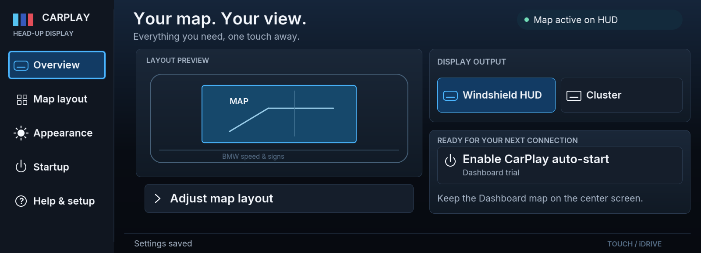
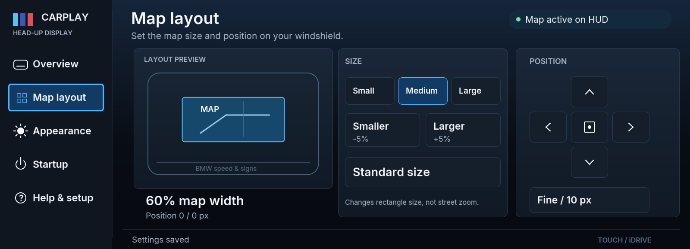
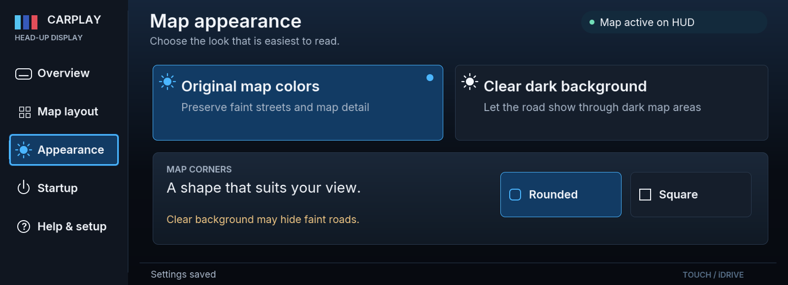
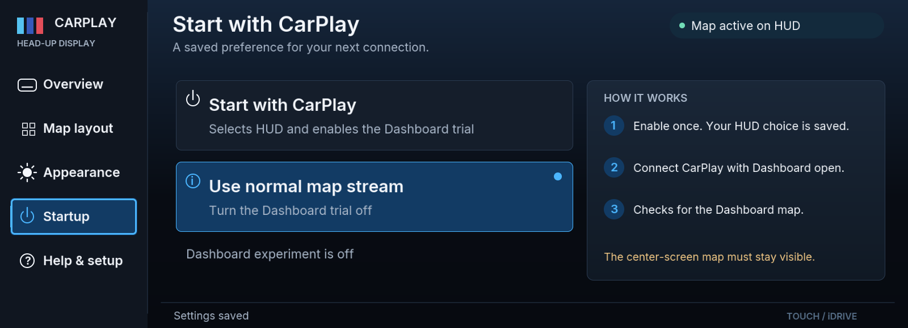
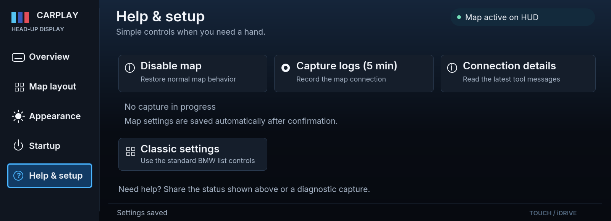

# CarPlay HUD graphical settings — 0.4.116

An iDrive 8-inspired visual design within the existing iDrive 7 app: dark navy
panels, blue focus and selection accents, a fixed left menu and large touch targets.
This is an independent app design, not BMW firmware or an iDrive upgrade.

The images below are **PC renders of the actual app drawing commands with sample
status**. They are not screenshots from the car. Physical fit, touch routing and
the controller must still be confirmed on the target head unit.

## Overview

HUD selection, cluster selection and the saved Dashboard startup trial are on one
screen. The schematic is labelled Layout Preview; it is not a live map.



## Map layout

Size presets, smaller/larger, standard size, a directional pad, centering and
fine/coarse movement share one page. The preview follows confirmed values. Width
changes the map rectangle; it does not change Apple Maps street zoom. BMW speed
and speed-limit widgets remain in their original positions.



## Appearance

Original colors preserve dark map pixels; clearing the background can remove
faint streets. Unsupported controls are disabled. The Dashboard startup trial
uses its own original-color, square-corner output.



## Startup and help

The existing optional Dashboard trial remains available with clear saved-state
feedback and instructions. It is not a new startup implementation and remains
unverified on the car. The center-screen Dashboard map must stay visible.





## Runtime and fallback

- Requires map tool **0.7.113** and **MGU Renderer 0.6.11**. MGU Renderer comes from
  the official MGU Store source and is distinct from cluster-render.
- The renderer places the app in its reported app area, fits the 1600 × 580 layout
  and requires the foreground gate. The native BMW title bar remains outside it.
- Touch gestures must start and end on the same control; dragging cancels a tap.
  iDrive dial rotation and pressing select controls. Native focus proxies remain
  available on renderers without the controller gate.
- A popup or hidden app releases touch and controller claims. Renderer loss or a
  rendering error restores classic native settings. Help → Classic settings also
  switches back; Open modern settings returns when the renderer is available.
- All setting actions use the existing SettingsControl confirmation path. A socket
  write is not presented as a saved setting; live and saved acknowledgments are
  still required. Unsupported or busy controls cannot execute.
- No proprietary BMW fonts, logos, SDK or firmware assets are included.

## Verification

`node apps/robertn_waze_cluster/tools/test_design.js` exercises the real renderer
wire client against a local protocol fixture, and actual SettingsControl against
fake map tools. It covers font uploads, placement, frames, touch and dial actions,
settings acknowledgments, hidden input, drag cancellation, fallback, control bounds,
licenses and unit-linkable module imports.

`test_page.js` covers the app entry mapping, actual state-focus field, native button
bindings, graphic/classic switching and renderer-disconnection fallback. The
existing control, profile and settings tests also run. These checks do not emulate
the BMW compositor or prove the design on the physical screen.

Regenerate these previews from the implementation:

```
node apps/robertn_waze_cluster/tools/preview_design.js docs/hud-research/design
```

## Public dependencies and licenses

Drawing code, client and font atlases were copied from
[robertnisipeanu/mgu-store at ee34705](https://github.com/robertnisipeanu/mgu-store/tree/ee34705eb3e682949acaf9106155a740f1012982):

- `apps/robertn_store/src/kit_record.js` and `kit_canvas.js`: MIT, cauliflowermossgrape.
- `native/mgu-render/js/mgu_render_client.js`: public MIT client; original source
  notices retained.
- `apps/robertn_store/src/font_regular.js` and `font_semibold.js`: Inter atlases,
  SIL Open Font License. Original font license is bundled.
- `kit_fonts.js`: minimal English font adapter based on the same public kit;
  selects and caches the original regular/semibold atlases.

The distributed app includes `licenses/LICENSE-kit.txt` and
`licenses/LICENSE-Inter.txt`. New app integration, screens and tests are GPL-3.0-or-later.
